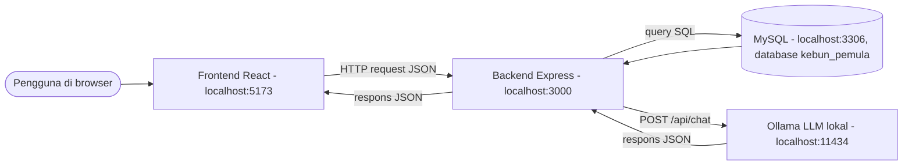
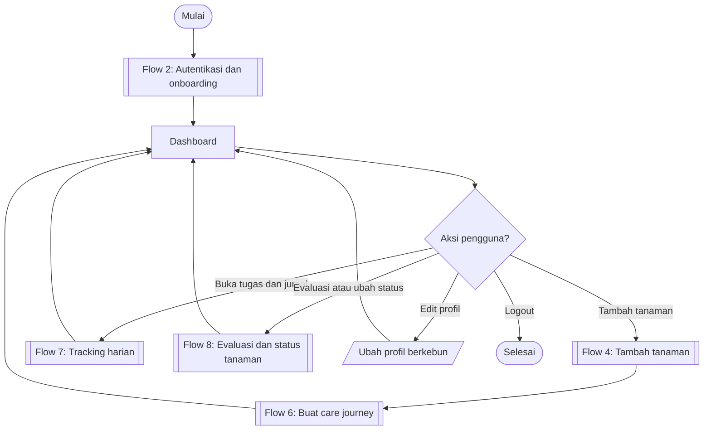
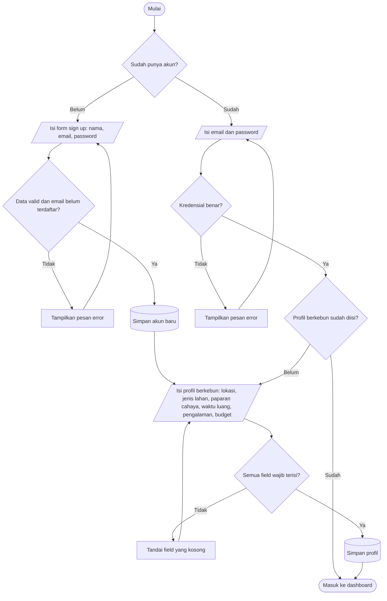
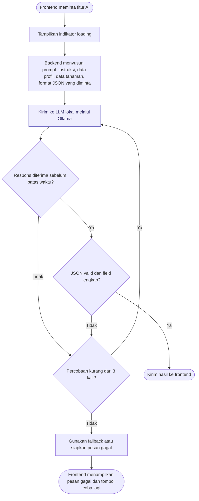
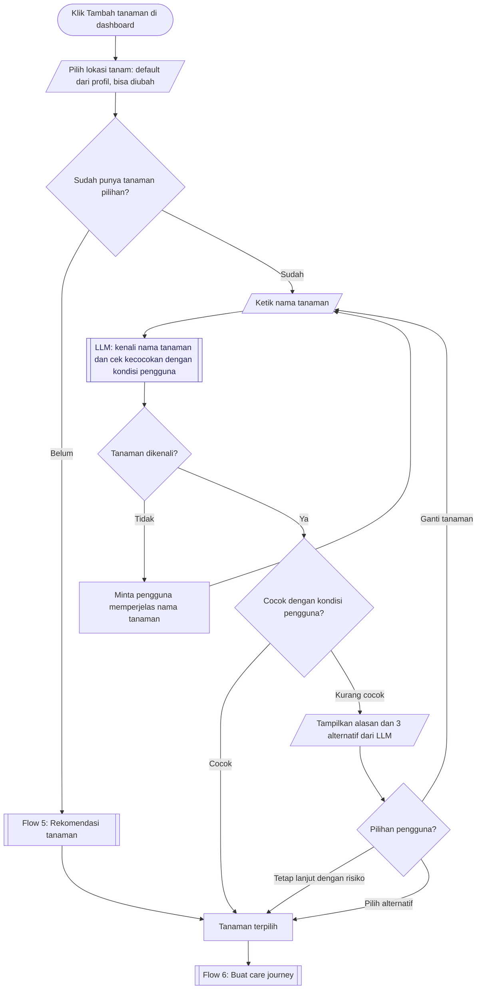
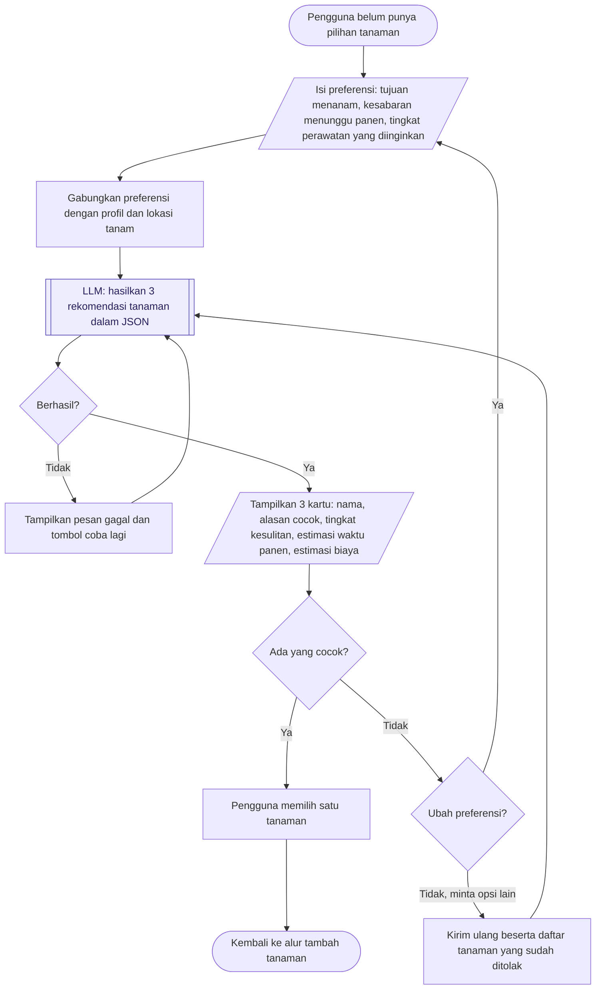
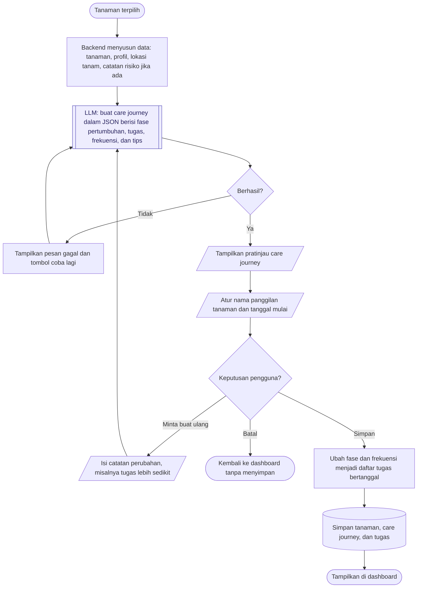
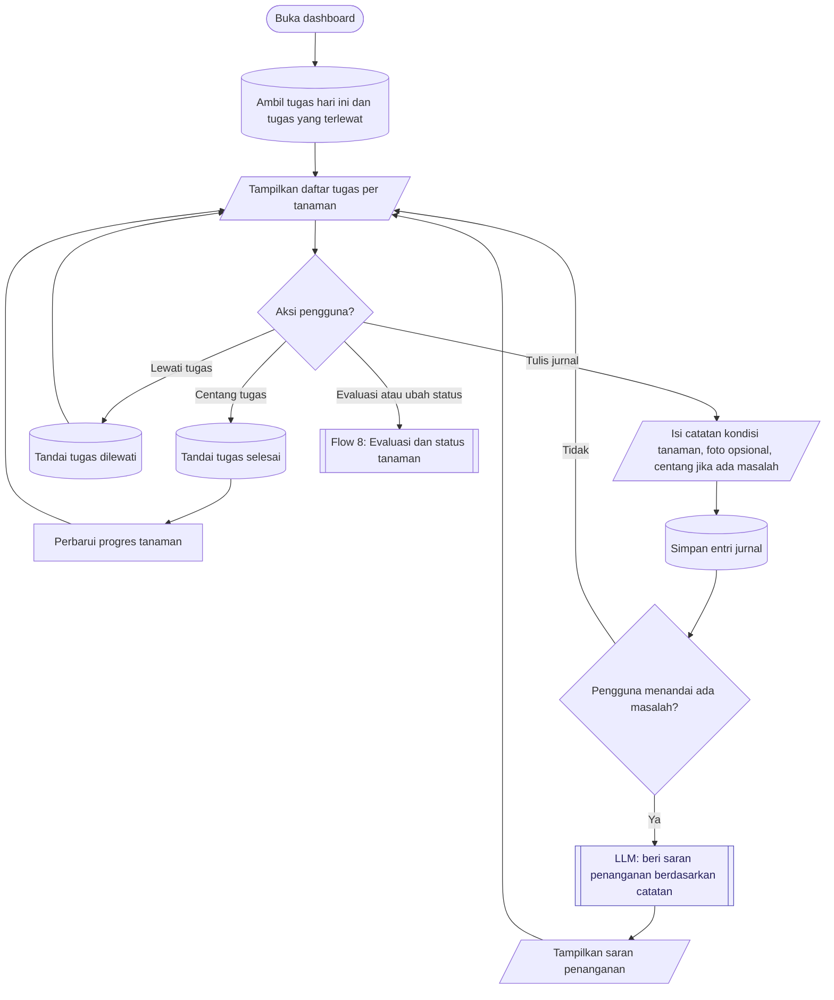
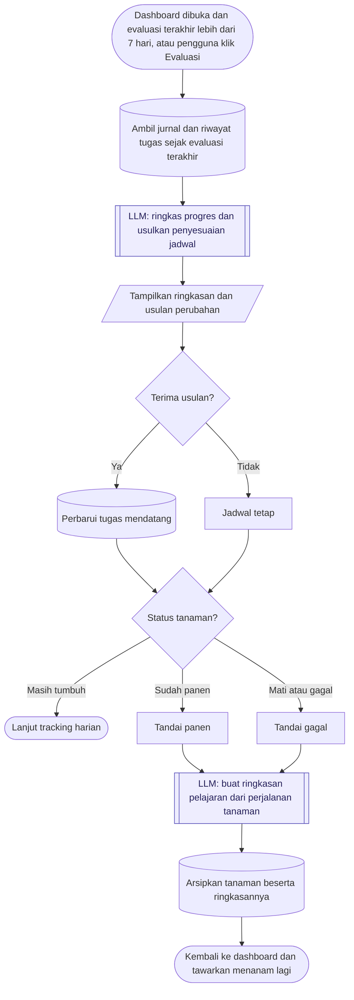
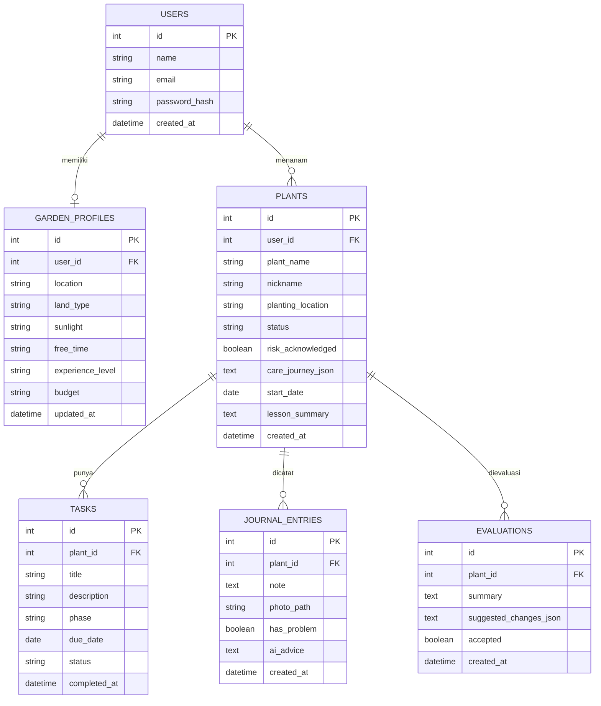

# 🌱 Kebun Pemula — Website Berkebun Berbantuan AI

> **Catatan:** "Kebun Pemula" adalah nama sementara. Ganti di seluruh dokumen ini setelah tim menyepakati nama final.

Website untuk membantu orang yang ingin mulai berkebun, tetapi pengetahuannya masih terbatas. Pengguna mendapat rekomendasi tanaman yang sesuai dengan kondisi dan kepribadiannya, jadwal perawatan (care journey) yang dipersonalisasi oleh AI, serta fitur untuk mencatat dan memantau perkembangan tanamannya.

Proyek ini adalah tugas kuliah tim 2 orang dengan durasi pengerjaan **1 bulan**. Tujuan utamanya adalah **belajar pemrograman web full stack dan integrasi model AI (LLM)**.

---

## Daftar isi

1. [Latar belakang](#1-latar-belakang)
2. [Tujuan pembelajaran](#2-tujuan-pembelajaran)
3. [Fitur utama](#3-fitur-utama)
4. [Tech stack](#4-tech-stack)
5. [Arsitektur sistem](#5-arsitektur-sistem)
6. [Struktur folder](#6-struktur-folder)
7. [Alur sistem (flowchart)](#7-alur-sistem-flowchart)
8. [Model data (database)](#8-model-data-database)
9. [Rancangan API](#9-rancangan-api)
10. [Integrasi LLM](#10-integrasi-llm)
11. [Cara menjalankan proyek](#11-cara-menjalankan-proyek)
12. [Konvensi tim](#12-konvensi-tim)
13. [Timeline dan progres](#13-timeline-dan-progres)
14. [Catatan keputusan desain](#14-catatan-keputusan-desain)
15. [Batasan yang diketahui](#15-batasan-yang-diketahui)
16. [Glosarium](#16-glosarium)

---

## 1. Latar belakang

| | |
|---|---|
| **Target pengguna** | Pemula di bidang pertanian/berkebun: orang yang ingin mulai berkebun, baik yang sudah punya tanaman incaran maupun yang belum tahu harus menanam apa. |
| **Masalah** | Kesulitan untuk memulai, dan bingung memilih tanaman yang sesuai untuk dirawat dengan kondisi lingkungan dan dirinya sendiri. |
| **Solusi** | Rekomendasi tanaman dan care journey yang dipersonalisasi oleh AI berdasarkan lingkungan, kepribadian, dan kebutuhan pengguna, lalu dilanjutkan dengan tracking perawatan. |
| **Poin utama** | Personalisasi, dengan 2 jalur: (1) pengguna sudah punya pilihan tanaman, (2) pengguna dibantu memilih tanaman. |
| **Hasil yang diharapkan** | Pengguna terbantu untuk memulai dan memilih tanaman yang sesuai dengan lingkungan dan dirinya sendiri. |

---

## 2. Tujuan pembelajaran

Karena ini proyek belajar, setiap fitur sebaiknya dikaitkan dengan skill yang ingin dikuasai:

| Skill | Dipelajari lewat |
|---|---|
| Frontend dengan framework | Membangun halaman dan komponen dengan React |
| Backend dan REST API | Membuat endpoint dengan Express |
| Database relasional | Merancang tabel dan relasi (user → tanaman → tugas → jurnal) |
| Autentikasi | Sign up, login, hashing password, token |
| Integrasi AI | Memanggil LLM lokal, menyusun prompt, memvalidasi output JSON |
| Penanganan error | Retry, timeout, fallback, pesan error untuk pengguna |
| Kolaborasi | Git, pembagian tugas, dokumentasi |

---

## 3. Fitur utama

### Fitur wajib (MVP)

- **Autentikasi:** sign up, login, logout.
- **Profil berkebun:** diisi sekali saat onboarding (lokasi, jenis lahan, paparan cahaya, waktu luang, pengalaman, budget), dan bisa diedit.
- **Tambah tanaman, jalur "sudah punya pilihan":** pengguna mengetik nama tanaman → LLM mengecek apakah tanaman dikenali dan cocok → jika kurang cocok, tampilkan alasan dan alternatif.
- **Tambah tanaman, jalur "belum punya pilihan":** pengguna mengisi preferensi → LLM memberi 3 rekomendasi → pengguna memilih satu.
- **Care journey:** LLM membuat jadwal perawatan (fase, tugas, frekuensi, tips) → pengguna melihat pratinjau dan mengonfirmasi → disimpan sebagai daftar tugas bertanggal.
- **Dashboard dan tracking harian:** daftar tugas hari ini, centang tugas selesai, lewati tugas, lihat progres.

### Fitur tambahan (jika waktu cukup)

- **Jurnal tanaman:** catatan kondisi dan foto; jika pengguna menandai ada masalah, LLM memberi saran penanganan.
- **Evaluasi berkala:** ringkasan progres mingguan dan usulan penyesuaian jadwal dari LLM.
- **Status dan arsip tanaman:** tandai panen atau gagal, lalu LLM membuat ringkasan pelajaran.

---

## 4. Tech stack

| Lapisan | Teknologi | Alasan |
|---|---|---|
| Frontend | **React** (dibuat dengan **Vite**) | Library frontend paling banyak dipakai di industri; Vite membuat setup sederhana dan cepat. |
| Routing frontend | React Router | Navigasi antarhalaman (login, dashboard, detail tanaman). |
| Backend | **Node.js + Express** | Satu bahasa (JavaScript) untuk frontend dan backend; Express sederhana dan banyak tutorialnya. |
| Database | **MySQL** (diakses dengan library `mysql2`) | Database relasional yang paling banyak dipakai di industri; banyak tutorialnya dan bisa dikelola lewat tool GUI seperti MySQL Workbench, phpMyAdmin (XAMPP), atau DBeaver. |
| Autentikasi | `bcrypt` (hash password) + `jsonwebtoken` (JWT) | Pola autentikasi yang umum dipakai. |
| AI | **Ollama** + model open-source kecil | Gratis dan berjalan di laptop sendiri; menyediakan API lokal di `http://localhost:11434`. |
| Lainnya | `cors`, `dotenv` | Mengizinkan frontend memanggil backend; menyimpan konfigurasi di file `.env`. |

**Model LLM yang disarankan:** model kecil sekitar 3–8 miliar parameter, misalnya `llama3.2:3b` atau `qwen2.5:3b`, atau model lain dari library Ollama. Pilih yang paling lancar di laptop anggota tim yang paling rendah spesifikasinya. Dengan RAM 8–16 GB, model kecil sudah cukup, meskipun responsnya bisa beberapa detik.

> **Penting:** website ini **tidak memakai data iklim atau API cuaca**. Lokasi diisi pengguna sebagai teks (misalnya "Gianyar, Bali, dataran rendah"), lalu LLM yang menyimpulkan kondisi iklimnya. Semua rekomendasi, pengecekan kecocokan, dan care journey dihasilkan oleh LLM di latar belakang.

---

## 5. Arsitektur sistem



### Pembagian tanggung jawab

| Komponen | Tugas | Yang **tidak** boleh dilakukan |
|---|---|---|
| **Frontend (React)** | Menampilkan halaman, mengambil input pengguna, validasi ringan, menampilkan loading dan error. | Memanggil Ollama langsung, atau menyimpan logika bisnis penting. |
| **Backend (Express)** | Autentikasi, validasi data, akses database, menyusun prompt, memanggil LLM, memvalidasi output LLM. | Mengirim output LLM ke frontend tanpa divalidasi. |
| **Database (MySQL)** | Menyimpan akun, profil, tanaman, tugas, jurnal, evaluasi. | — |
| **LLM (Ollama)** | Menghasilkan rekomendasi, cek kecocokan, care journey, saran, dan ringkasan dalam format JSON. | Menjadi sumber kebenaran data. Data yang sudah dikonfirmasi pengguna disimpan di database. |

**Prinsip utama:** frontend hanya bicara dengan backend. Semua pemanggilan AI lewat backend, supaya prompt, validasi, dan penanganan error ada di satu tempat.

---

## 6. Struktur folder

Struktur awal yang disarankan (boleh disesuaikan, tetapi perbarui bagian ini jika berubah):

```
kebun-pemula/
├── README.md
├── client/                     # Frontend React (Vite)
│   ├── src/
│   │   ├── pages/              # Halaman: Login, Register, Onboarding, Dashboard, AddPlant, PlantDetail
│   │   ├── components/         # Komponen yang dipakai ulang: TaskItem, PlantCard, LoadingSpinner
│   │   ├── services/           # Fungsi pemanggil API backend (api.js)
│   │   ├── context/            # State global, misalnya AuthContext
│   │   ├── App.jsx             # Daftar route
│   │   └── main.jsx
│   └── package.json
└── server/                     # Backend Express
    ├── src/
    │   ├── routes/             # Definisi endpoint: auth.js, profile.js, plants.js, tasks.js, journal.js, ai.js
    │   ├── controllers/        # Logika tiap endpoint
    │   ├── services/
    │   │   └── llm/
    │   │       ├── ollamaClient.js   # Fungsi umum pemanggil Ollama (retry, timeout)
    │   │       ├── prompts.js        # Semua template prompt
    │   │       └── validators.js     # Validasi bentuk JSON dari LLM
    │   ├── middleware/         # authMiddleware.js (cek token)
    │   ├── db/
    │   │   ├── schema.sql      # Definisi tabel MySQL (CREATE DATABASE + CREATE TABLE)
    │   │   ├── seed.sql        # Data contoh untuk testing (opsional)
    │   │   └── index.js        # Connection pool MySQL dengan mysql2
    │   └── app.js              # Entry point server
    ├── .env.example
    └── package.json
```

---

## 7. Alur sistem (flowchart)

Flowchart dipecah menjadi 8 bagian. Kotak bergaris ganda berarti sub-proses yang dirinci di flow lain, dan kotak ungu menandai langkah yang memanggil LLM.

### Flow 1: Gambaran umum



### Flow 2: Autentikasi dan onboarding



### Flow 3: Pola pemanggilan LLM (dipakai di semua fitur AI)

Flow ini menggambarkan apa yang terjadi di dalam setiap kotak ungu pada flow lain.



### Flow 4: Tambah tanaman



### Flow 5: Rekomendasi tanaman



### Flow 6: Buat care journey



### Flow 7: Tracking harian



### Flow 8: Evaluasi berkala dan status tanaman



---

## 8. Model data (database)

Rancangan awal untuk **MySQL**. Jika tabel atau kolom berubah, perbarui diagram dan tabel di bagian ini **sebelum** mengubah `schema.sql`, supaya dokumentasi dan kode tetap sinkron.



### Penjelasan kolom penting

| Tabel.kolom | Nilai yang mungkin | Keterangan |
|---|---|---|
| `garden_profiles.land_type` | `balkon`, `pekarangan`, `pot_dalam_ruangan`, `lainnya` | Pilihan dropdown di form onboarding. |
| `garden_profiles.sunlight` | `penuh`, `sebagian`, `sedikit` | Perkiraan paparan matahari per hari. |
| `plants.planting_location` | teks bebas | Default diambil dari profil, bisa diubah per tanaman. |
| `plants.status` | `growing`, `harvested`, `failed` | Status perjalanan tanaman. |
| `plants.risk_acknowledged` | `true` / `false` | `true` jika pengguna tetap lanjut padahal LLM menilai kurang cocok. |
| `plants.care_journey_json` | JSON | Salinan lengkap care journey dari LLM yang sudah dikonfirmasi pengguna. |
| `tasks.status` | `pending`, `done`, `skipped` | Status tugas harian. |

### `schema.sql` (MySQL)

Versi awal skema yang sesuai dengan ERD di atas. Simpan di `server/src/db/schema.sql`.

```sql
CREATE DATABASE IF NOT EXISTS kebun_pemula
  CHARACTER SET utf8mb4 COLLATE utf8mb4_unicode_ci;
USE kebun_pemula;

CREATE TABLE users (
  id INT AUTO_INCREMENT PRIMARY KEY,
  name VARCHAR(100) NOT NULL,
  email VARCHAR(255) NOT NULL UNIQUE,
  password_hash VARCHAR(255) NOT NULL,
  created_at DATETIME NOT NULL DEFAULT CURRENT_TIMESTAMP
) ENGINE=InnoDB;

CREATE TABLE garden_profiles (
  id INT AUTO_INCREMENT PRIMARY KEY,
  user_id INT NOT NULL UNIQUE,
  location VARCHAR(255) NOT NULL,
  land_type ENUM('balkon','pekarangan','pot_dalam_ruangan','lainnya') NOT NULL,
  sunlight ENUM('penuh','sebagian','sedikit') NOT NULL,
  free_time VARCHAR(50) NOT NULL,
  experience_level VARCHAR(50) NOT NULL,
  budget VARCHAR(50) NOT NULL,
  updated_at DATETIME NOT NULL DEFAULT CURRENT_TIMESTAMP ON UPDATE CURRENT_TIMESTAMP,
  FOREIGN KEY (user_id) REFERENCES users(id) ON DELETE CASCADE
) ENGINE=InnoDB;

CREATE TABLE plants (
  id INT AUTO_INCREMENT PRIMARY KEY,
  user_id INT NOT NULL,
  plant_name VARCHAR(100) NOT NULL,
  nickname VARCHAR(100),
  planting_location VARCHAR(255) NOT NULL,
  status ENUM('growing','harvested','failed') NOT NULL DEFAULT 'growing',
  risk_acknowledged BOOLEAN NOT NULL DEFAULT FALSE,
  care_journey_json JSON NOT NULL,
  start_date DATE NOT NULL,
  lesson_summary TEXT,
  created_at DATETIME NOT NULL DEFAULT CURRENT_TIMESTAMP,
  FOREIGN KEY (user_id) REFERENCES users(id) ON DELETE CASCADE
) ENGINE=InnoDB;

CREATE TABLE tasks (
  id INT AUTO_INCREMENT PRIMARY KEY,
  plant_id INT NOT NULL,
  title VARCHAR(150) NOT NULL,
  description TEXT,
  phase VARCHAR(100),
  due_date DATE NOT NULL,
  status ENUM('pending','done','skipped') NOT NULL DEFAULT 'pending',
  completed_at DATETIME NULL,
  FOREIGN KEY (plant_id) REFERENCES plants(id) ON DELETE CASCADE,
  INDEX idx_tasks_due (plant_id, due_date, status)
) ENGINE=InnoDB;

CREATE TABLE journal_entries (
  id INT AUTO_INCREMENT PRIMARY KEY,
  plant_id INT NOT NULL,
  note TEXT NOT NULL,
  photo_path VARCHAR(255),
  has_problem BOOLEAN NOT NULL DEFAULT FALSE,
  ai_advice TEXT,
  created_at DATETIME NOT NULL DEFAULT CURRENT_TIMESTAMP,
  FOREIGN KEY (plant_id) REFERENCES plants(id) ON DELETE CASCADE
) ENGINE=InnoDB;

CREATE TABLE evaluations (
  id INT AUTO_INCREMENT PRIMARY KEY,
  plant_id INT NOT NULL,
  summary TEXT NOT NULL,
  suggested_changes_json JSON,
  accepted BOOLEAN NULL,
  created_at DATETIME NOT NULL DEFAULT CURRENT_TIMESTAMP,
  FOREIGN KEY (plant_id) REFERENCES plants(id) ON DELETE CASCADE
) ENGINE=InnoDB;
```

Catatan untuk MySQL:
- `ON DELETE CASCADE` berarti jika satu tanaman dihapus, tugas, jurnal, dan evaluasinya ikut terhapus.
- `BOOLEAN` di MySQL sebenarnya disimpan sebagai `TINYINT(1)`, jadi nilainya terbaca `0` atau `1` di JavaScript.
- Kolom bertipe `JSON` otomatis divalidasi MySQL; data yang bukan JSON valid akan ditolak.
- Charset `utf8mb4` dipakai supaya teks berbahasa Indonesia, simbol seperti "–", dan emoji tersimpan dengan benar.

### Koneksi database dari backend

```js
// server/src/db/index.js
import mysql from "mysql2/promise";

export const pool = mysql.createPool({
  host: process.env.DB_HOST,
  port: Number(process.env.DB_PORT) || 3306,
  user: process.env.DB_USER,
  password: process.env.DB_PASSWORD,
  database: process.env.DB_NAME,
  waitForConnections: true,
  connectionLimit: 10,
});
```

Contoh pemakaian di controller:

```js
import { pool } from "../db/index.js";

// Selalu gunakan placeholder ? untuk input pengguna (mencegah SQL injection)
const [rows] = await pool.query(
  "SELECT * FROM tasks WHERE plant_id = ? AND due_date <= CURDATE() AND status = 'pending'",
  [plantId]
);
```

Saat menyimpan tanaman beserta tugas-tugasnya (Flow 6), gunakan **transaksi** supaya data tidak tersimpan setengah jika ada error di tengah jalan:

```js
const conn = await pool.getConnection();
try {
  await conn.beginTransaction();
  const [result] = await conn.query("INSERT INTO plants (...) VALUES (...)", [/* ... */]);
  // ... INSERT ke tabel tasks dengan plant_id = result.insertId
  await conn.commit();
} catch (err) {
  await conn.rollback();
  throw err;
} finally {
  conn.release();
}
```

---

## 9. Rancangan API

Semua endpoint diawali `/api`. Endpoint bertanda 🔒 membutuhkan header `Authorization: Bearer <token>`.

### Autentikasi dan profil

| Method | Endpoint | Fungsi |
|---|---|---|
| POST | `/api/auth/register` | Membuat akun baru |
| POST | `/api/auth/login` | Login, mengembalikan token JWT |
| GET 🔒 | `/api/profile` | Mengambil profil berkebun |
| PUT 🔒 | `/api/profile` | Membuat atau memperbarui profil berkebun |

### Fitur AI

| Method | Endpoint | Fungsi | Flow |
|---|---|---|---|
| POST 🔒 | `/api/ai/check-plant` | Mengenali nama tanaman dan cek kecocokan | Flow 4 |
| POST 🔒 | `/api/ai/recommend` | Menghasilkan 3 rekomendasi tanaman | Flow 5 |
| POST 🔒 | `/api/ai/care-journey` | Membuat pratinjau care journey (belum disimpan) | Flow 6 |
| POST 🔒 | `/api/ai/advice` | Saran penanganan masalah dari jurnal | Flow 7 |
| POST 🔒 | `/api/ai/evaluate/:plantId` | Ringkasan progres dan usulan perubahan jadwal | Flow 8 |

### Tanaman, tugas, dan jurnal

| Method | Endpoint | Fungsi |
|---|---|---|
| GET 🔒 | `/api/plants` | Daftar tanaman milik pengguna |
| POST 🔒 | `/api/plants` | Menyimpan tanaman beserta care journey yang sudah dikonfirmasi, sekaligus membuat tugasnya |
| GET 🔒 | `/api/plants/:id` | Detail satu tanaman |
| PATCH 🔒 | `/api/plants/:id/status` | Mengubah status (`harvested` / `failed`) |
| GET 🔒 | `/api/tasks/today` | Tugas hari ini dan tugas terlewat |
| PATCH 🔒 | `/api/tasks/:id` | Mengubah status tugas (`done` / `skipped`) |
| GET 🔒 | `/api/plants/:id/journal` | Daftar jurnal satu tanaman |
| POST 🔒 | `/api/plants/:id/journal` | Menambah entri jurnal |

### Format respons standar

Supaya frontend selalu tahu cara membaca respons, semua endpoint memakai bentuk yang sama:

```json
// Berhasil
{ "success": true, "data": { } }

// Gagal
{ "success": false, "error": { "code": "AI_TIMEOUT", "message": "AI sedang sibuk, silakan coba lagi." } }
```

---

## 10. Integrasi LLM

### Cara backend memanggil Ollama

Backend mengirim request ke API lokal Ollama. Contoh sederhana:

```js
// server/src/services/llm/ollamaClient.js
const OLLAMA_URL = process.env.OLLAMA_URL || "http://localhost:11434";
const MODEL = process.env.OLLAMA_MODEL || "llama3.2:3b";

export async function askLLM(systemPrompt, userPrompt) {
  const res = await fetch(`${OLLAMA_URL}/api/chat`, {
    method: "POST",
    headers: { "Content-Type": "application/json" },
    body: JSON.stringify({
      model: MODEL,
      stream: false,
      format: "json", // meminta Ollama mengembalikan JSON
      messages: [
        { role: "system", content: systemPrompt },
        { role: "user", content: userPrompt },
      ],
    }),
  });
  const data = await res.json();
  return JSON.parse(data.message.content);
}
```

Fungsi di atas masih versi paling dasar. Versi final perlu ditambah **timeout**, **retry hingga 3 kali**, dan **validasi** sesuai Flow 3.

### Aturan menulis prompt

1. Semua prompt disimpan di `prompts.js`, jangan ditulis tersebar di controller.
2. Selalu sebutkan **bentuk JSON yang diharapkan** secara eksplisit di prompt.
3. Masukkan data pengguna (profil, lokasi tanam, preferensi) sebagai data terstruktur, bukan kalimat panjang.
4. Minta jawaban dalam **Bahasa Indonesia** dan dengan bahasa yang ramah pemula.
5. Setiap perubahan prompt yang signifikan dicatat di [Catatan keputusan desain](#14-catatan-keputusan-desain).

### Kontrak JSON tiap fitur

Ini "kesepakatan" antara backend dan frontend. Validator di `validators.js` mengecek bentuk ini sebelum data dikirim ke frontend.

**`/api/ai/check-plant`**
```json
{
  "recognized": true,
  "normalized_name": "Cabai rawit",
  "suitable": false,
  "reason": "Lokasi di dalam ruangan dengan sedikit cahaya kurang ideal karena cabai butuh matahari penuh.",
  "alternatives": [
    { "name": "Sirih gading", "reason": "Tahan cahaya rendah dan mudah dirawat." }
  ]
}
```

**`/api/ai/recommend`**
```json
{
  "recommendations": [
    {
      "name": "Kangkung",
      "reason": "Cepat panen dan cocok untuk pemula dengan waktu luang sedikit.",
      "difficulty": "mudah",
      "harvest_time": "3–4 minggu",
      "estimated_cost": "Rp20.000–50.000"
    }
  ]
}
```

**`/api/ai/care-journey`**
```json
{
  "plant_name": "Kangkung",
  "phases": [
    {
      "name": "Penyemaian",
      "duration_days": 7,
      "tasks": [
        { "title": "Siram media tanam", "frequency_days": 1, "description": "Jaga tanah tetap lembap, jangan sampai tergenang." }
      ],
      "tips": ["Letakkan di tempat teduh pada minggu pertama."]
    }
  ]
}
```

Backend mengubah `phases` dan `frequency_days` menjadi baris-baris di tabel `tasks` dengan `due_date` dihitung dari `start_date`.

**`/api/ai/advice`**
```json
{ "possible_causes": ["Penyiraman berlebihan"], "advice": ["Kurangi penyiraman menjadi 2 hari sekali."] }
```

**`/api/ai/evaluate/:plantId`**
```json
{
  "summary": "Tanaman tumbuh baik, 9 dari 10 tugas minggu ini selesai.",
  "suggested_changes": [
    { "task_title": "Siram media tanam", "new_frequency_days": 2, "reason": "Daun mulai menguning, tanda terlalu basah." }
  ]
}
```

### Penanganan kegagalan

| Situasi | Penanganan |
|---|---|
| LLM tidak merespons dalam batas waktu | Coba ulang hingga 3 kali, lalu tampilkan pesan dan tombol coba lagi. |
| Output bukan JSON valid atau field kurang | Anggap gagal, lalu coba ulang. |
| Ollama tidak berjalan | Kembalikan error `AI_UNAVAILABLE` dengan pesan yang jelas. |
| Care journey gagal terus | Gunakan template care journey umum (fallback) yang disimpan di kode. |

---

## 11. Cara menjalankan proyek

### Prasyarat

- [Node.js](https://nodejs.org/) versi LTS
- [MySQL](https://dev.mysql.com/downloads/mysql/) 8.x, atau MySQL/MariaDB bawaan [XAMPP](https://www.apachefriends.org/)
- Tool GUI database (opsional): MySQL Workbench, phpMyAdmin, atau DBeaver
- [Ollama](https://ollama.com/)
- Git

### Langkah pertama kali

```bash
# 1. Clone repositori
git clone <url-repo>
cd kebun-pemula

# 2. Unduh model LLM (sekali saja)
ollama pull llama3.2:3b

# 3. Buat database dan tabel (pastikan server MySQL sudah menyala)
mysql -u root -p < server/src/db/schema.sql

# 4. Siapkan backend
cd server
npm install
cp .env.example .env      # lalu sesuaikan isinya
npm run dev               # berjalan di http://localhost:3000

# 5. Siapkan frontend (terminal baru)
cd client
npm install
npm run dev               # berjalan di http://localhost:5173
```

Pastikan **server MySQL** dan **aplikasi Ollama** sedang berjalan sebelum menjalankan backend. Jika memakai XAMPP, nyalakan modul MySQL dari XAMPP Control Panel; langkah 3 juga bisa dilakukan dengan meng-import `schema.sql` lewat phpMyAdmin.

### Isi `.env.example`

```env
PORT=3000
JWT_SECRET=ganti_dengan_string_acak
DB_HOST=localhost
DB_PORT=3306
DB_USER=root
DB_PASSWORD=isi_password_mysql_kalian
DB_NAME=kebun_pemula
OLLAMA_URL=http://localhost:11434
OLLAMA_MODEL=llama3.2:3b
LLM_TIMEOUT_MS=60000
```

File `.env` **tidak boleh** di-commit. Pastikan sudah tercantum di `.gitignore`.

### Perintah awal saat membuat proyek dari nol

Untuk catatan, berikut perintah yang dipakai saat setup pertama:

```bash
# Frontend
npm create vite@latest client -- --template react
cd client && npm install react-router-dom

# Backend
mkdir server && cd server
npm init -y
npm install express cors dotenv mysql2 bcrypt jsonwebtoken
npm install --save-dev nodemon
```

---

## 12. Konvensi tim

### Pembagian peran

| Anggota | Fokus utama | Juga ikut mengerjakan |
|---|---|---|
| _Nama anggota 1_ | Frontend React | Minimal 1 endpoint backend |
| _Nama anggota 2_ | Backend Express + integrasi LLM | Minimal 1 halaman frontend |

Tujuannya agar keduanya tetap belajar full stack.

### Git

- **Branch utama:** `main` selalu dalam kondisi bisa dijalankan.
- **Branch fitur:** `feature/nama-fitur`, misalnya `feature/login`, `feature/care-journey`.
- **Perbaikan bug:** `fix/deskripsi-singkat`.
- Gabungkan ke `main` lewat pull request, dan minta anggota lain melihat sekilas sebelum merge.

**Format pesan commit:**

```
feat: tambah halaman login
fix: perbaiki validasi email di register
docs: perbarui rancangan API di README
refactor: pindahkan prompt ke prompts.js
```

### Definisi "selesai"

Sebuah fitur dianggap selesai jika:

- [ ] Berjalan di laptop kedua anggota tim.
- [ ] Menangani kondisi error (input kosong, AI gagal, data tidak ditemukan).
- [ ] README diperbarui jika ada perubahan alur, tabel, atau endpoint.
- [ ] Sudah di-merge ke `main`.

---

## 13. Timeline dan progres

Centang setiap item yang sudah selesai.

### Minggu 1: Fondasi
- [ ] Belajar dasar React (komponen, props, state, `useEffect`)
- [ ] Belajar dasar Express (route, request, response)
- [ ] Setup repositori, struktur folder, dan `.gitignore`
- [ ] Install Ollama dan coba memanggil model dari backend
- [ ] Install MySQL, buat `schema.sql`, dan koneksi database dengan `mysql2`

### Minggu 2: Fitur dasar
- [ ] Register dan login (backend + frontend)
- [ ] Middleware autentikasi
- [ ] Form onboarding profil berkebun
- [ ] Kerangka halaman dashboard

### Minggu 3: Fitur AI utama
- [ ] `ollamaClient.js` dengan timeout, retry, dan validasi
- [ ] Cek kecocokan tanaman (Flow 4)
- [ ] Rekomendasi tanaman (Flow 5)
- [ ] Care journey: pratinjau, konfirmasi, simpan tugas (Flow 6)
- [ ] Tracking tugas harian (Flow 7)

### Minggu 4: Penyempurnaan
- [ ] Fitur tambahan: jurnal, evaluasi, status tanaman (jika waktu cukup)
- [ ] Perapian tampilan dan pesan error
- [ ] Testing seluruh alur dari awal sampai akhir
- [ ] Finalisasi README dan persiapan presentasi

---

## 14. Catatan keputusan desain

Catat setiap keputusan penting di sini beserta alasannya, supaya kalian ingat kenapa sesuatu dibuat seperti itu (dan bisa menjelaskannya saat presentasi).

| Tanggal | Keputusan | Alasan |
|---|---|---|
| 2026-11-01 | Memilih ide website untuk pemula berkebun, bukan prediksi masa tanam berbasis machine learning | Lebih sesuai dengan stack JavaScript, tidak butuh dataset berlabel, risiko gagal dalam 1 bulan lebih rendah, dan porsi belajar web lebih besar. |
| 2026-11-01 | Stack: React (Vite), Express, MySQL, Ollama | Satu bahasa untuk frontend dan backend, gratis, dan bisa berjalan sepenuhnya lokal. |
| 2026-11-01 | Database diganti dari SQLite ke MySQL | MySQL paling banyak dipakai di industri dan di perkuliahan, sehingga lebih bernilai untuk dipelajari. Konsekuensinya, setiap anggota perlu menjalankan server MySQL di laptopnya. |
| 2026-11-01 | Tidak memakai data iklim atau API cuaca; semua dari LLM | Menyederhanakan arsitektur; lokasi diisi sebagai teks dan LLM yang menyimpulkan kondisinya. |
| 2026-11-01 | Profil berkebun diisi sekali saat onboarding | Pengguna tidak perlu mengisi ulang setiap kali menambah tanaman. |
| 2026-11-01 | Lokasi tanam disimpan per tanaman, dengan default dari profil | Satu pengguna bisa punya tanaman di beberapa tempat (misalnya balkon dan dalam kamar). |
| 2026-11-01 | Evaluasi berkala dipicu saat dashboard dibuka | Website hanya berjalan lokal, jadi server belum tentu menyala tepat setiap 7 hari. |
| 2026-11-01 | Foto di jurnal hanya disimpan, tidak dianalisis | LLM teks tidak bisa membaca gambar; analisis foto butuh model vision. |
| 2026-11-01 | Care journey ditampilkan sebagai pratinjau sebelum disimpan | Pengguna bisa meminta perubahan atau membatalkan sebelum data masuk database. |

---

## 15. Batasan yang diketahui

- **Akurasi AI terbatas.** Model kecil bisa memberi informasi yang keliru (halusinasi). Tampilkan label seperti _"Saran ini dihasilkan AI, sesuaikan dengan kondisi tanamanmu"_ di setiap hasil AI.
- **Respons bisa lambat.** Model lokal butuh beberapa detik hingga puluhan detik, tergantung spesifikasi laptop. Indikator loading wajib ada.
- **Kualitas tergantung model.** Hasil bisa berbeda antar model dan antar laptop. Sepakati satu model yang sama untuk seluruh tim.
- **Hanya berjalan lokal.** Website belum di-deploy, dan setiap anggota perlu menjalankan MySQL dan Ollama sendiri.
- **Data tidak otomatis sama antar laptop.** Setiap anggota punya database MySQL sendiri. Gunakan `schema.sql` (dan `seed.sql` jika ada) yang di-commit ke Git supaya struktur tabel selalu sama, dan jangan meng-commit isi database.
- **Kondisi iklim hanya disimpulkan LLM** dari teks lokasi, bukan dari data cuaca nyata.

---

## 16. Glosarium

| Istilah | Arti |
|---|---|
| **Frontend** | Bagian website yang dilihat dan digunakan pengguna di browser. |
| **Backend** | Program di server yang memproses data, mengakses database, dan memanggil AI. |
| **API / endpoint** | "Pintu" di backend yang bisa dipanggil frontend, misalnya `POST /api/auth/login`. |
| **REST** | Gaya merancang API dengan method HTTP (GET, POST, PUT, PATCH, DELETE). |
| **JSON** | Format teks untuk bertukar data, misalnya `{ "nama": "Kangkung" }`. |
| **JWT** | Token yang diberikan setelah login dan dikirim di setiap request untuk membuktikan identitas pengguna. |
| **LLM** | Large Language Model, model AI yang memahami dan menghasilkan teks. |
| **Ollama** | Aplikasi untuk menjalankan LLM open-source di komputer sendiri. |
| **Prompt** | Instruksi dan data yang dikirim ke LLM. |
| **Halusinasi** | Saat LLM menghasilkan informasi yang terdengar meyakinkan tetapi salah. |
| **Fallback** | Rencana cadangan ketika proses utama gagal. |
| **Care journey** | Rangkaian fase dan tugas perawatan tanaman dari awal tanam hingga panen. |
| **MVP** | Minimum Viable Product, versi paling sederhana yang sudah bisa dipakai. |
| **CRUD** | Create, Read, Update, Delete: operasi dasar pada data. |
| **MySQL** | Sistem database relasional berbasis server; data disimpan dalam tabel dan diakses dengan bahasa SQL. |
| **Connection pool** | Kumpulan koneksi database yang dipakai ulang supaya backend tidak membuka koneksi baru di setiap request. |
| **SQL injection** | Serangan dengan menyisipkan perintah SQL lewat input pengguna; dicegah dengan placeholder `?` (prepared statement). |
